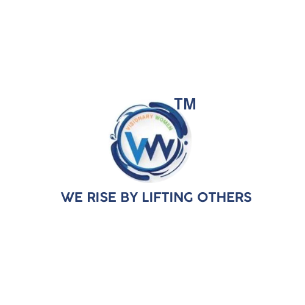

# Visionary Women (VW) — Official Web Platform

> **"We Rise by Lifting Others"**  
> **Hubs:** Surat | Pune (Pan-India & Global Engagements)



A web platform combining the institutional authority of a premier Chartered Accountancy & financial consulting firm with an empowering, women-led professional ecosystem.

---

## 🌟 Overview

**Visionary Women** connects ambitious commercial enterprises and CA firms with qualified women professionals (Chartered Accountants, Company Secretaries, and Cost & Management Accountants) through flexible, remote-first opportunities and institutional-grade financial deliverables.

### Institutional Pillars
- **Virtual CFO & Strategic Advisory**: 5-year dynamic modeling, CMA dossiers, unit economics optimization.
- **Accounting & Financial Operations**: Cloud bookkeeping, payroll processing, accounts receivable auditing.
- **Direct & Indirect Taxation**: Corporate tax returns, GST compliance, high-stakes CIT(Appeals) & ITAT litigation.
- **Corporate & Secretarial Governance**: ROC filings, company incorporation (Pvt Ltd, LLP), statutory registers.
- **Corporate Legal & Regulatory**: FEMA, IEC, cross-border compliance, commercial contracts, trademark protection.
- **Executive Branding & Thought Leadership**: C-Suite LinkedIn strategy, B2B presence, corporate pitch decks.

---

## 💎 Features & Architecture

- **Interactive 3D Hero Sculpture**: Custom Three.js WebGL orbital installation inspired by the Visionary Women logo with real-time mouse parallax, dual-speed concentric torus rings, and 300+ glowing particles.
- **Cinematic Loader**: GSAP timeline loader with animated SVG circular progress ring, real-time percentage counter, and curtain clip-path exit.
- **Pinned Triad Storyline**: GSAP ScrollTrigger pinned 3-stage sequence (*Your Expertise. Your Opportunity. Your Future.*).
- **3D Interactive Tilt Cards**: Perspective tilt on mouse movement with dynamic glare spotlighting and deep-dive service modal view.
- **Authentic Memory Gallery**: 40 curated conference and summit photographs with category filtering (Conferences, Community, Executive, Workshops) and an interactive lightbox.
- **Dual-Purpose Consultation Desk**: Interactive switching between Enterprise Outsourcing and Professional Network Onboarding with validation and NDA compliance guarantee.
- **Typography & Brand Identity System**:
  - **Headlines / Display**: Anton, Oswald, Montserrat
  - **Body / Interface**: DM Sans, Montserrat
  - **Editorial & Quotes**: Lora (Italic)
  - **Colors**: Primary Navy (`#01155B`), Deep Navy (`#010521`), Teal (`#47C8BF`), Orange (`#FF8F00`), Yellow (`#FFDE59`)

---

## 🚀 Technology Stack

- **Framework**: [React 18](https://react.dev/) + [TypeScript](https://www.typescriptlang.org/)
- **Build Tool**: [Vite](https://vitejs.dev/)
- **Styling**: [Tailwind CSS](https://tailwindcss.com/)
- **3D Graphics**: [Three.js](https://threejs.org/)
- **Animation Engine**: [GSAP](https://gsap.com/) + [ScrollTrigger](https://gsap.com/docs/v3/Plugins/ScrollTrigger/)
- **Icons**: [Lucide React](https://lucide.dev/)

---

## 🛠️ Getting Started

### Prerequisites
- Node.js (v18 or higher recommended)
- npm or pnpm

### Installation
```bash
git clone https://github.com/Kaushaltiwari27/visionary_women.git
cd visionary_women
npm install
```

### Development Server
```bash
npm run dev
```

### Production Build
```bash
npm run build
npm run preview
```

---

## 🏛️ Leadership

- **Founder**: **CA Crispee Morakhiya** (Chartered Accountant & CS background, Mentor at ICAI Surat, Author on Tax Guru).
- **Vision**: To be recognized among the top 4 CA firms in India through an inclusive, remote-first model unlocking untapped women professional potential.

---

## 📄 License & NDA

© Visionary Women. All rights reserved. Strict NDA and confidentiality standards apply to all client advisory and financial engagements.
